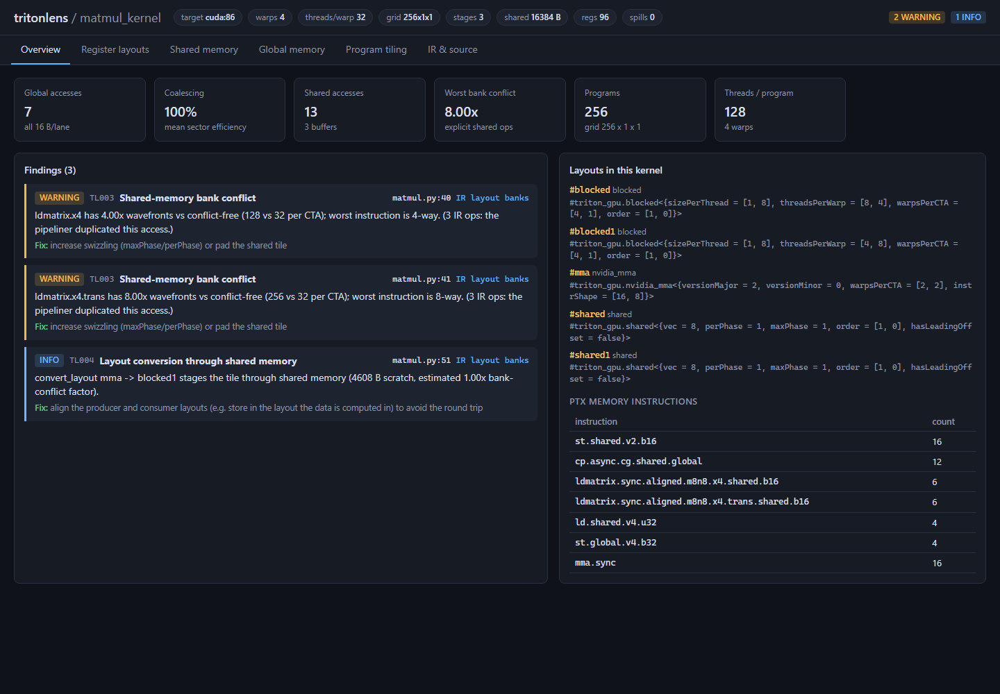
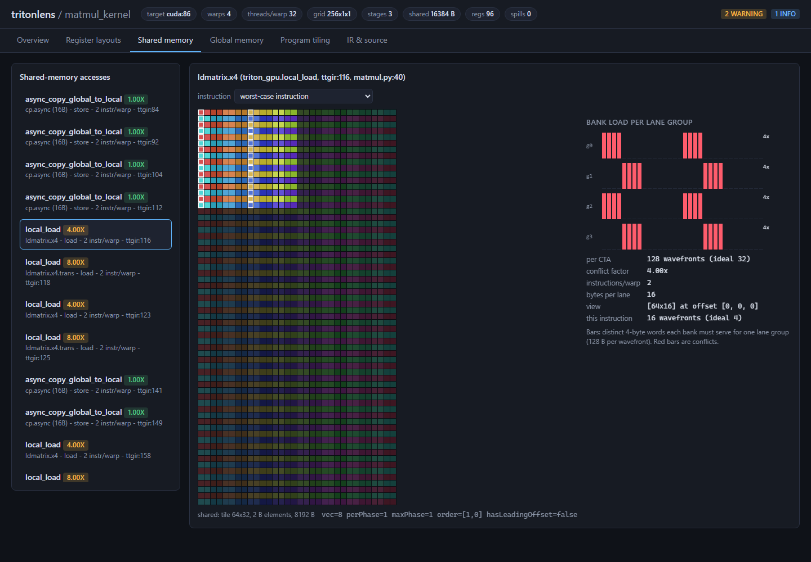
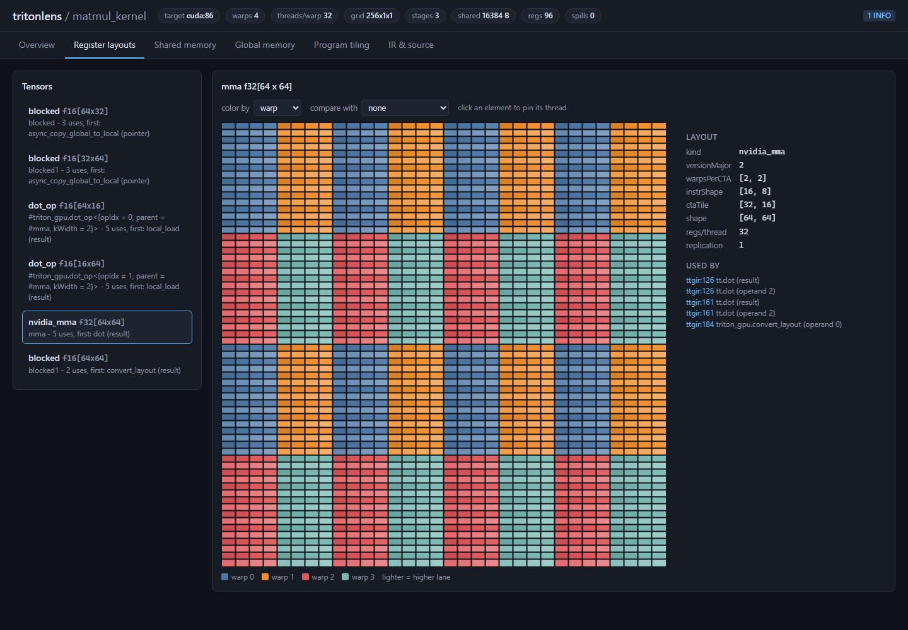
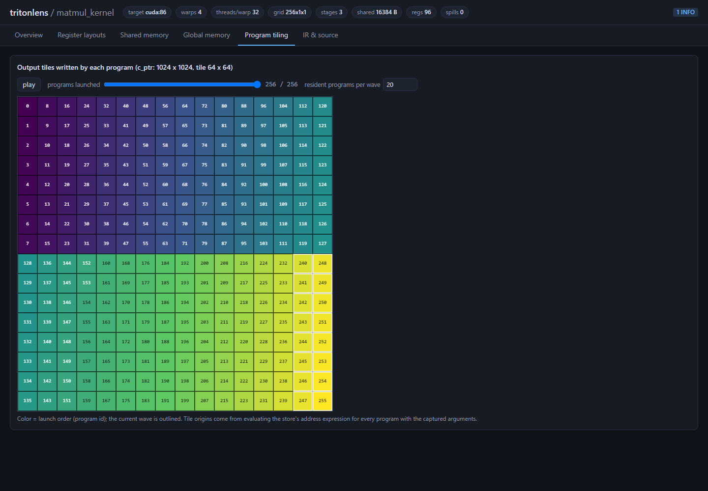
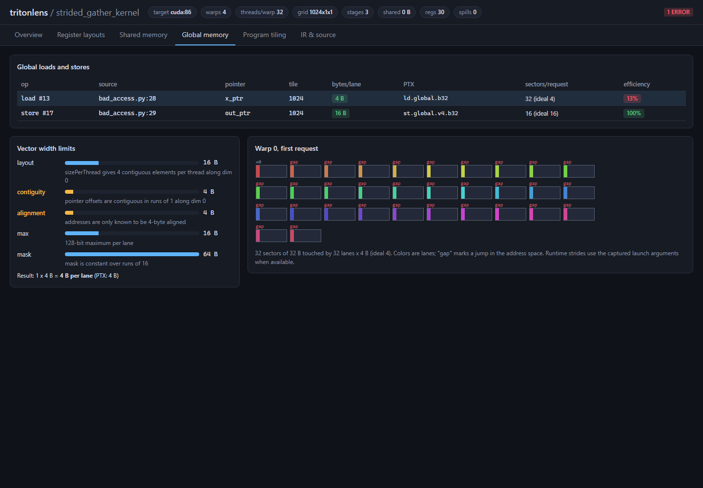
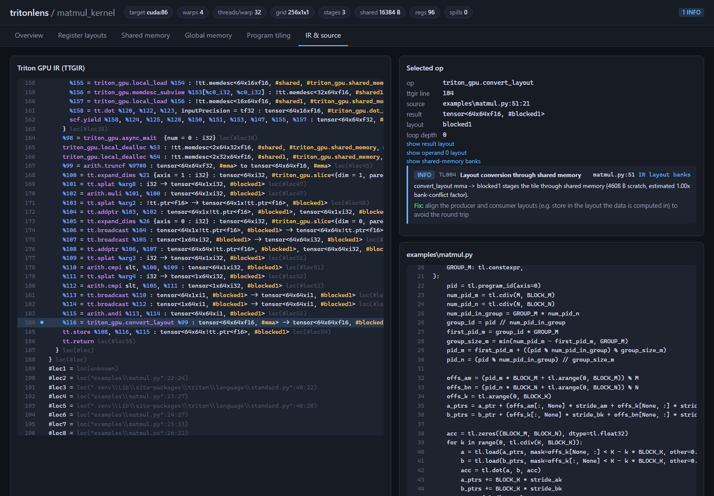
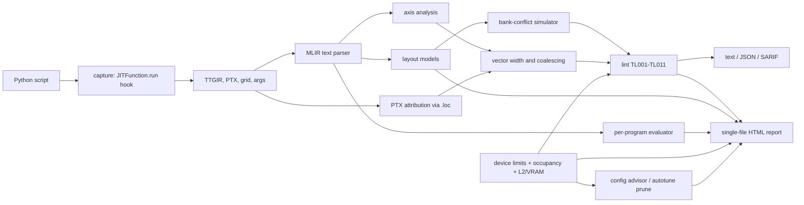

# tritonlens: see how a Triton kernel lays out memory

`tritonlens` is a static analysis pass and interactive visualizer for
[Triton](https://github.com/triton-lang/triton) GPU kernels. It reads the Triton GPU IR
(TTGIR) that the compiler produces and answers the questions that usually need hours with
Nsight and a whiteboard:

- Which thread holds which element of every tensor, for `blocked`, `slice`, `nvidia_mma` and
  `dot_op` layouts?
- How is each shared-memory tile swizzled, and do `ldmatrix`, `cp.async` and register spills
  into shared memory hit **bank conflicts**?
- Is each global load **coalesced** and **vectorized**? If not, which argument, stride or mask
  is to blame?
- Which output tile does each program write, and in what order are programs launched?

The results come out as compiler-style diagnostics (text, JSON or SARIF) and as a single
self-contained HTML report that works offline.



Every model is checked against the hardware. The layout models match the RTX 3050 Ti
**element for element (26/26 probes)**. Predicted shared-memory wavefronts track measured
matmul time with **r = 0.94**. A predicted 12% sector efficiency turned into a measured
**4.3x** slowdown. See [benchmarks/results.md](benchmarks/results.md).

## Quick start

```bash
pip install -e ".[gpu]"          # torch + triton (triton-windows on Windows)
tritonlens run examples/matmul.py -o reports/     # capture, analyze, write HTML
tritonlens lint examples/bad_access.py            # compiler-style findings
tritonlens device --calibrate                     # measure this GPU's peaks (cached)
tritonlens advise examples/matmul.py              # tiles/stages that fit this GPU
tritonlens validate                               # check the layout models on your GPU
```

On Windows, pick the `triton-windows` release that matches your PyTorch build, for example
`pip install "triton-windows<3.3"` for PyTorch 2.6.

`tritonlens run` executes the script, records every kernel it launches (all IR stages, the
grid, and the real argument values and strides), then writes one report per kernel plus an
`index.html`. Kernels compiled elsewhere can be analyzed from their IR:

```bash
tritonlens analyze my_kernel.ttgir -o report.html   # reads my_kernel.ptx / .launch.json if present
tritonlens lint dumps/ --format sarif -o tritonlens.sarif --fail-on error
```

The analysis needs no GPU; only `run` and `validate` do. CI lints and renders the checked-in
fixture kernels on a CPU-only runner.

### From Python

```python
import tritonlens
from tritonlens.report import build_report, write_html

with tritonlens.capturing() as rec:          # records every Triton launch inside the block
    matmul_kernel[grid](a, b, c, M, N, K, ...)

for kernel in rec:
    an = tritonlens.analyze_captured(kernel)
    write_html(build_report(an), f"{kernel.name}.html")

# Pre-launch checks: catches misaligned tensors before Triton compiles a slow specialization.
for finding in tritonlens.check(add_kernel, x[1:], y[1:], out[1:], n - 1, BLOCK_SIZE=1024):
    print(finding.message)

with tritonlens.guard(raise_on="warning"):   # raise instead of silently running slower
    add_kernel[grid](x[1:], y[1:], out[1:], n - 1, BLOCK_SIZE=1024)

# Drop A100-sized autotune configs before Triton compiles them (seconds each, often OOM).
@triton.autotune(configs=CONFIGS, key=["M", "N", "K"],
                 prune_configs_by={"early_config_prune": tritonlens.device_pruner()})
@triton.jit
def matmul_kernel(...):
    ...
```

## The report

| | |
|---|---|
|  | **Shared memory.** The bank map of every buffer shows the swizzle pattern. Pick an access and an instruction to see which lanes touch which banks; the bars count the distinct 4-byte words each bank must serve per 128-byte wavefront, with conflicts in red. Shown: an `ldmatrix.x4` on an unswizzled tile, 4-way conflicted. |
|  | **Register layouts.** Every tensor's layout drawn element by element. Color by warp, lane, thread or register, hover for owners and replication, click to pin one thread's elements, or compare two layouts of the same shape side by side. Shown: an `mma.sync.m16n8k16` accumulator on a 2x2 warp grid. |
|  | **Program tiling.** The output tile each `program_id` writes, colored by launch order, with a play button and wave outlines. Shown: the grouped ordering (GROUP_M=8) that improves L2 reuse in matmul. |
|  | **Global memory.** The vector-width budget of every load and store (layout, contiguity, alignment, mask, 16-byte limit), cross-checked against the PTX the compiler emitted, plus the 32-byte sectors warp 0 touches. Shown: a stride-8 gather using 4 of 32 sectors. |
|  | **IR and source.** TTGIR with layouts highlighted and findings in the gutter, linked to the Python source line through `loc` metadata. |
| | **Performance.** Occupancy limiters (warps / registers / shared memory / block slots), programs-per-SM schedule, VRAM headroom, L2 A-stripe vs this GPU's cache, a roofline using calibrated peaks, and a table of tile/pipeline configs that actually fit. Tuned for small GPUs: a 20-SM, 4 GB, 2 MB-L2 laptop part is the development target. |

## Lint rules

| rule | finds | example message |
|---|---|---|
| **TL001** | global access narrower than 16 B per lane, and the factor that limits it | *Load uses 4-byte accesses per lane; 16-byte vectors are possible. Limited by: the offset is computed from `in_row_stride`, which is not divisible by 16 ... PTX confirms: ld.global.b32.* |
| **TL002** | uncoalesced access: 32-byte sectors per warp request compared with the ideal | *Load touches 32.0 sectors per warp request where 4.0 would suffice (12% efficiency): neighbouring lanes are 8 elements apart.* |
| **TL003** | shared-memory bank conflicts on `ldmatrix`, `ld/st.shared` and `cp.async` | *ldmatrix.x4.trans has 8.00x wavefronts vs conflict-free (256 vs 32 per CTA); worst instruction is 8-way.* |
| **TL004** | `convert_layout` that round-trips through shared memory (scratch size, estimated conflicts) | *convert_layout blocked1 -> blocked stages the tile through shared memory (17408 B scratch, estimated 4.50x bank-conflict factor).* |
| **TL005** | wasted threads: layouts that replicate a small tensor, or mostly-masked blocks | *Mask against `n_cols`=781 keeps only 76% of the 1024-wide block active in every program.* |
| **TL006** | launch arguments that defeat Triton's 16-byte specialization (offset views, odd row pitch) | *`x_ptr` (float32[1048576]) starts 4 bytes past a 16-byte boundary: Triton will not mark it tt.divisibility=16 and `misaligned_add_kernel` falls back to narrow loads/stores.* |
| **TL007** | register spills, or occupancy too low to hide DRAM latency | *Occupancy 8% on RTX 3050 Ti (20 SMs). Memory-bound kernels need many warps in flight.* |
| **TL008** | SM load imbalance: the grid does not divide evenly over this GPU's SMs | *25 equal-work programs on 20 SMs: the kernel takes as long as 40 programs would (62% SM utilization). Measured: 21 matmul tiles vs 20 doubled run time.* |
| **TL009** | software-pipelined shared memory leaves room for only 1 block/SM | *num_stages=5 buffers 64 KiB of operand tiles; this GPU has 100 KiB per SM, so only 1 block fits. num_stages=3: 3 blocks (25%).* |
| **TL010** | VRAM headroom: tensors leave too little room on a small GPU | *Launch tensors occupy 3.1 GiB of 4.0 GiB. Triton also needs several hundred MB to compile a new specialization.* |
| **TL011** | grouped-matmul A-stripe does not fit in this GPU's L2 | *GROUP_M=8 wants 4.0 MiB of A in L2 so neighbouring programs reuse it. This GPU has 2 MiB (an A100 has 40 MiB). GROUP_M=4 would fit.* |

Severities are calibrated against measurements. A narrow access that still fills every sector
measured within 6% of a 16-byte one on a DRAM-bound kernel, so it is reported as `info`. An
uncoalesced access measured 4.3x slower, so it is reported as an `error`. Device rules
TL007-TL009 were timed on the 3050 Ti: fixing a 25-program 128x128 matmul to 64x64 was
**1.63x**, splitting an 8-row reduction across 20 SMs was **1.80x**, and dropping
num_stages 5→4 (1→2 blocks/SM) was **1.09x**. See [benchmarks/results.md](benchmarks/results.md).

## How it works



- **Capture** (`capture.py`). A context manager wraps `JITFunction.run`. Each launch yields the
  `CompiledKernel` with every IR stage, plus the resolved grid and a description of every
  argument (pointer value, shape, strides). Triton drops constexprs and integers equal to 1 from
  the compiled signature; the IR arguments are mapped back to Python names with the same rule.
- **Parser** (`ir/`). A dependency-free parser for the textual TTGIR that Triton prints. It
  covers layout aliases, inline encodings, tensor and `memdesc` types, scoped SSA values in
  nested regions, loop-carried values (`iter_args` and `scf.yield`), generic-form ops such as
  `tt.reduce`, and `loc` resolution through `callsite` chains back to user code. It accepts both
  the `triton_gpu.` (3.2) and `ttg.` (3.3+) dialect prefixes.
- **Layout models** (`layouts/`). Each layout maps `(warp, lane, register)` to tensor
  coordinates with Triton's semantics: coordinates wrap and broadcast when the tensor is smaller
  than the CTA tile, and repeat in registers when it is larger. MMA v2 follows the PTX fragment
  layout with row-major warp order. `dot_op` operands broadcast across the warps that share a
  row or column of C. Shared layouts implement the XOR swizzle
  `col ^ (vec * ((row / perPhase) % maxPhase))`.
- **Bank-conflict simulator** (`analysis/banks.py`). Each warp instruction is split into
  128-byte wavefronts: the full warp for 4-byte accesses, half-warps for 8 bytes, and
  quarter-warps or `ldmatrix` phases for 16 bytes. The number of wavefronts is the largest count
  of distinct words any one bank serves. Views are resolved through `memdesc_subview` chains and
  loop-carried buffers back to their `local_alloc`, so the K-offset subtiles of a pipelined
  matmul land on the right banks.
- **Axis analysis** (`analysis/axis.py`). Per-dimension contiguity, divisibility and constancy,
  following Triton's `AxisInfo`. These are the facts that decide vector width. It also tracks
  symbolic strides (such as `1 * %arg6`), which become concrete with the captured argument
  values. The vector width is `min(layout, contiguity, alignment, mask, 16 B)`, and every
  factor is reported. The prediction matched the PTX in every tested kernel.
- **Tiling evaluator** (`analysis/tiling.py`). Evaluates the store's address expression at the
  tile corners for every `program_id` with the captured arguments, then maps byte offsets back
  to `(row, col)` through the destination's real strides. Grouped ordering, one-row-per-program
  kernels and transposed stores need no special cases.
- **Device model** (`device.py`, `analysis/occupancy.py`). Arch occupancy limits (registers,
  shared memory, warps, block slots), live `torch` properties, and optional measured peaks
  (`tritonlens device --calibrate`). The occupancy calculator matched
  `cuOccupancyMaxActiveBlocksPerMultiprocessor` on 207/207 configs of this GPU.
- **Roofline / VRAM / L2** (`analysis/perf.py`, `analysis/budget.py`). FLOPs from `tt.dot` ×
  loop trips × grid; DRAM bytes capped at each tensor's size; VRAM = unique tensor storage vs
  the card; L2 stripe = `GROUP_M * BLOCK_M * K * elem` for grouped matmul.
- **Config advisor / autotune prune** (`analysis/advise.py`, `autotune.py`). Host-side search
  for tiles that fill this GPU's SMs and fit in 100 KiB shared / 2 MB L2. `device_pruner()`
  drops those configs from `triton.autotune` *before* compilation.

## Validation

All results are in [benchmarks/results.md](benchmarks/results.md):

1. **Layout ground truth.** Probe kernels write `%tid.x`, read with
   `tl.inline_asm_elementwise`, into every element. The model's prediction for the layout Triton
   chose matches the GPU on all 58,496 elements across 26 configurations.
2. **Bank conflicts.** The real matmul TTGIR is recompiled with five different swizzles.
   Predicted wavefronts against measured time give r = 0.94 at 64x64 tiles. At 128x128 the
   kernel is bound by `mma` throughput and conflicts barely matter, which is why tritonlens
   reports a cost rather than a runtime.
3. **Global memory.** Flagged kernels are compared with their fixed variants. Sector efficiency
   predicts bandwidth; vector width alone does not, on a DRAM-bound kernel.
4. **Occupancy.** Predicted blocks/SM matched the CUDA driver on 207/207 register, shared-memory
   and warp-limited configs.
5. **SM balance.** Run time of equal-work matmul tiles follows `ceil(programs/SMs)` within 6%;
   the last-wave model is pessimistic when several blocks share an SM.
6. **Device-rule fixes.** TL007-TL009 suggestions timed on this GPU: 1.09x to 1.80x. A
   108-config A100-style autotune sweep at 640³ drops from 204 s (26 failed compiles) to
   60 s with the same winning kernel.

## Scope and limitations

- Tested with Triton 3.2 (`triton-windows` 3.2.0) on an Ampere GPU (sm_86). The parser accepts
  newer dialect names, but newer IR has not been tested.
- NVIDIA MMA v2 (Ampere) is modelled. Hopper `wgmma` (MMA v3, `nvmma_shared`) and AMD MFMA
  layouts are reported as unsupported rather than guessed.
- The shared scratch buffer of `convert_layout` is not visible in TTGIR. It is estimated from
  Triton's padded-scratch lowering and marked as estimated everywhere.
- Hardware bank-conflict counters (Nsight Compute) were not available on the development
  machine, so shared-memory predictions are validated through controlled timing.

## Repository layout

```
src/tritonlens/
  capture.py          launch capture and IR loading
  ir/                 TTGIR parser (attributes, types, ops, locations)
  layouts/            blocked, slice, mma v2, dot_op, shared (swizzle) models
  analysis/           axis info, banks, coalescing, PTX, tiling, occupancy, roofline, VRAM/L2, lint
  autotune.py         early_config_prune for small GPUs
  device.py           arch limits, detection, calibration
  report/             JSON builder and the single-file HTML/JS viewer
  cli.py              run | analyze | lint | validate | device | advise
examples/             kernels used as fixtures and benchmarks (incl. deliberately bad ones)
benchmarks/           swizzle sweep, lint-fix, occupancy, waves, device-rule and autotune studies
tests/                parser/model/analysis tests on checked-in IR; GPU tests marked `gpu`
```

## Development

```bash
python -m venv .venv && .venv/Scripts/activate      # Windows; use bin/activate elsewhere
pip install -e ".[gpu,dev]"
pytest                    # GPU tests run automatically when CUDA + Triton are present
ruff check src tests
python scripts/gen_fixtures.py   # refresh tests/fixtures from the examples (needs a GPU)
```

## License

MIT
